<div align="center">
  
  <h1>Auralis</h1>
  <p><b>A native YouTube Music player for Android, with synced lyrics and group listening</b></p>

  
  -32CD32?style=for-the-badge&logo=android&logoColor=white)
  
  
  
  
  [](https://www.buymeachai.in/shreyanshh071)

  <br />

  **Auralis** is an ad-free music player for Android that streams from YouTube Music, built natively with **Jetpack Compose**, **AndroidX Media3**, **Kotlin Coroutines** and **Material 3**.

  <br />

  [Website](https://auralis-self-nu.vercel.app) • [Download APK](https://github.com/Shreyanshh071/Auralis/releases/latest) • [Screenshots](#-screenshots) • [Features](#-key-features) • [FAQ](#-frequently-asked-questions-faq) • [Tech Stack](#%EF%B8%8F-architecture--tech-stack) • [Credits](#-credits) • [Sponsor](#-sponsor-this-project)

</div>

> [!WARNING]
> **Regional Restriction** — If YouTube Music is unavailable in your region, this app will not work without a VPN or proxy connecting to a supported region.

---

## 📦 Download

[Download the universal APK](https://github.com/Shreyanshh071/Auralis/releases/latest) for Android 7.0 and newer. [Release notes](docs/release-notes-v1.1.2.md) · [Release source](https://github.com/Shreyanshh071/Auralis/tree/v1.1.2)

The APK (~27 MB) supports Android 7.0+ devices with `arm64-v8a`, `armeabi-v7a`, `x86`, or `x86_64` CPUs. Most of its size is Discord's official SDK for Rich Presence, which includes native code for each of those processor types. The app itself is native Jetpack Compose, shrunk with R8.

---

## 📸 Screenshots

<div align="center">
  <table>
    <tr>
      <td align="center" width="25%">
        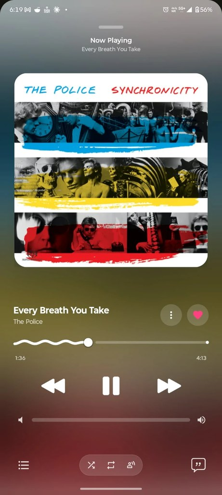<br />
        <sub><b>Now Playing</b></sub>
      </td>
      <td align="center" width="25%">
        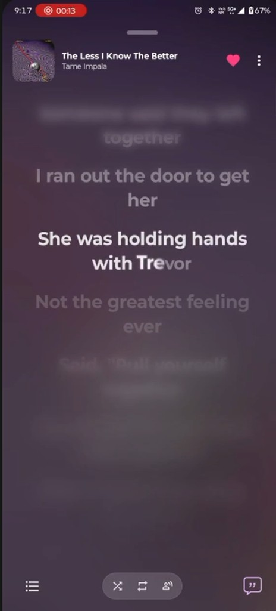<br />
        <sub><b>Karaoke Lyrics · Word-by-Word Sync</b></sub>
      </td>
      <td align="center" width="25%">
        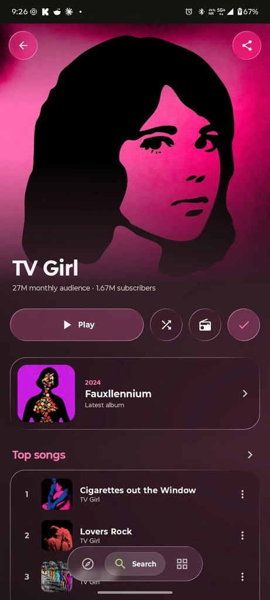<br />
        <sub><b>Artist Discography</b></sub>
      </td>
      <td align="center" width="25%">
        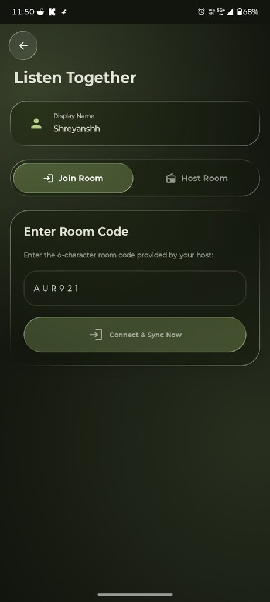<br />
        <sub><b>Listen Together</b></sub>
      </td>
    </tr>
    <tr>
      <td align="center" width="25%">
        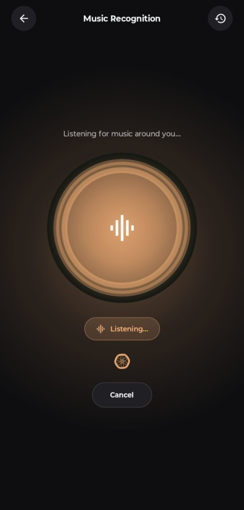<br />
        <sub><b>Music Recognition</b></sub>
      </td>
      <td align="center" width="25%">
        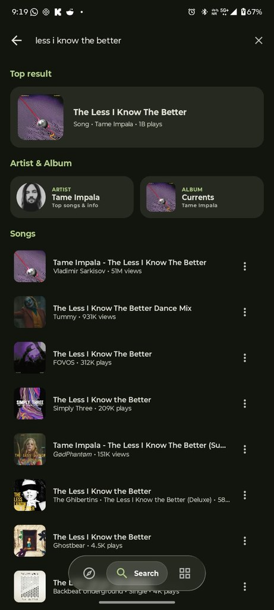<br />
        <sub><b>Search & Discovery</b></sub>
      </td>
      <td align="center" width="25%">
        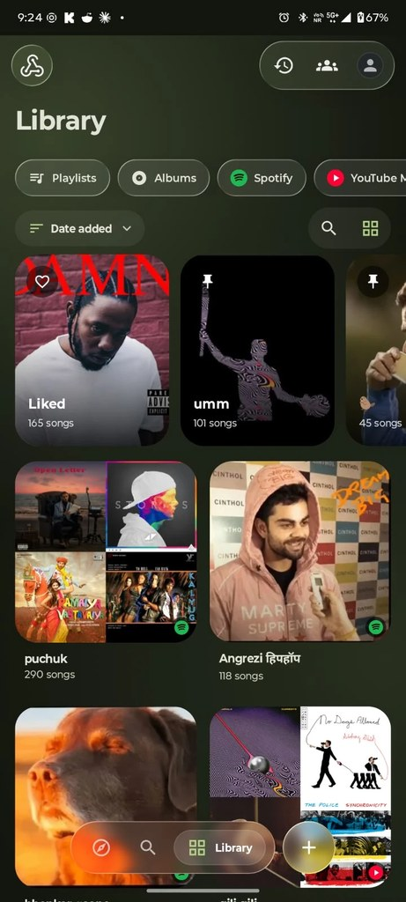<br />
        <sub><b>Library</b></sub>
      </td>
      <td align="center" width="25%">
        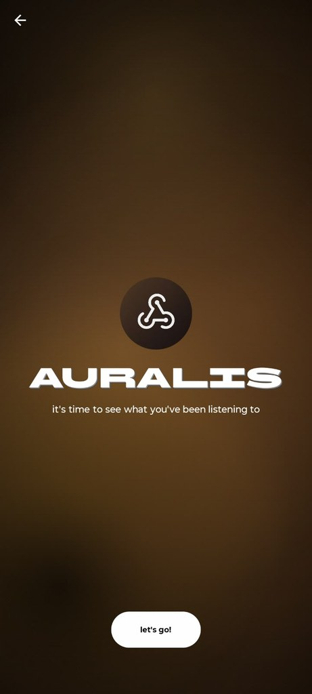<br />
        <sub><b>Auralis Wrapped</b></sub>
      </td>
    </tr>
    <tr>
      <td align="center" width="25%">
        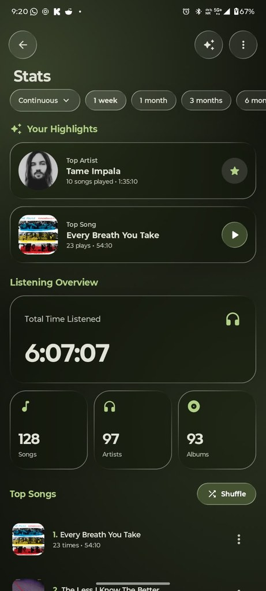<br />
        <sub><b>Listening Stats</b></sub>
      </td>
      <td align="center" width="25%">
        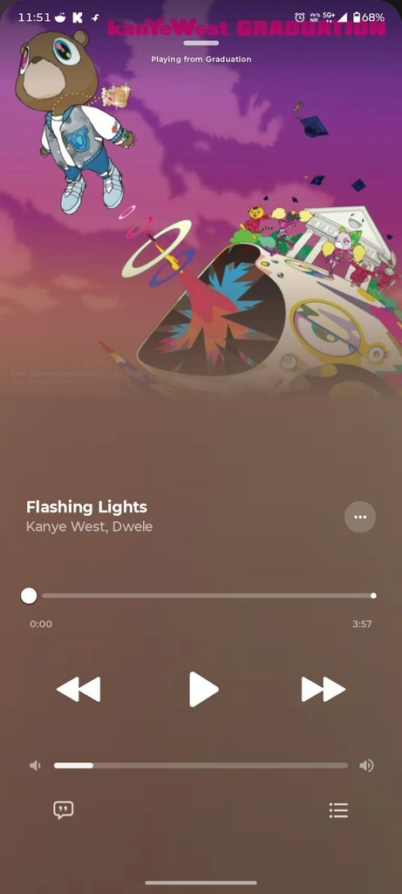<br />
        <sub><b>Immersive Player</b></sub>
      </td>
      <td align="center" width="25%">
        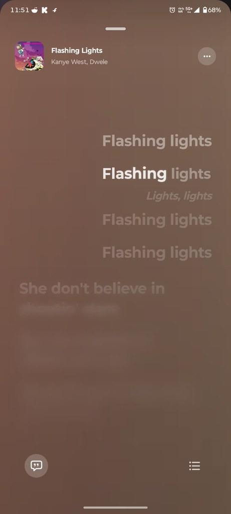<br />
        <sub><b>Player · Lyrics</b></sub>
      </td>
      <td align="center" width="25%">
        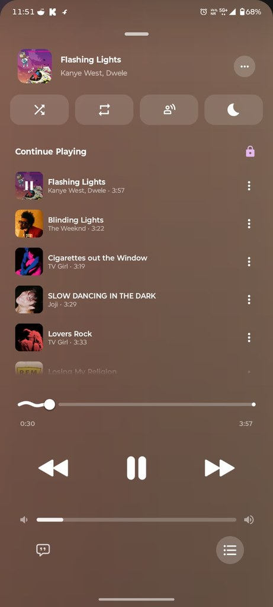<br />
        <sub><b>Player · Queue</b></sub>
      </td>
    </tr>
  </table>
</div>

---

## ✨ Key Features

<table>
<tr>
<td valign="top" width="50%">

#### Playback

- **Play anything available on YouTube Music** — search, browse and listen.
- **Offline downloads** — save songs and whole playlists.
- **Audio quality options** — choose Auto, High, Standard or Data Saver.
- **Sleep timer** to stop playback when you're done.
- **Background playback** with lock-screen and notification controls.

#### Together & Accounts

- **Listen Together** — join a room with a code and hear the same song with friends.
- **Spotify integration** — sign in to bring over your playlists and Liked Songs.
- **Playlist import** for Spotify and YouTube Music.
- **Discord Rich Presence** — show your song, artist, cover and progress.
- **Listening stats** — real listening time, top songs, top artists and Wrapped.

</td>
<td valign="top" width="50%">

#### Lyrics

- **Syllable-synced lyrics** — every word and syllable lights up as it's sung, with fluid animations that go well beyond standard animated lyrics. Sync and motion at this level are rarely found in a music player.
- **Lyrics providers** — credit to [Spicy Lyrics](https://github.com/Spikerko/spicy-lyrics), [Better Lyrics](https://github.com/better-lyrics/better-lyrics), [AMLL](https://github.com/amll-dev/amll-ttml-db), [LyricsPlus](https://github.com/ibratabian17/LyricsPlus), [Paxsenix](https://lyrics.paxsenix.org), [Unison](https://unison.boidu.dev), [LRCLIB](https://lrclib.net), [Musixmatch](https://www.musixmatch.com), [KuGou](https://www.kugou.com), [QQ Music](https://y.qq.com), [NetEase](https://music.163.com), [JioSaavn](https://www.jiosaavn.com), [Genius](https://genius.com) and [YouTube Music](https://music.youtube.com).

#### Experience

- **Liquid Glass mode** — a see-through glass look for the dock, buttons, sheets and menus on dark themes.
- **Animated album canvas** — motion artwork on the now-playing screen.
- **Three player designs** — New, Old and Immersive.
- **Artwork-driven colours** — the player takes its colours from the current song.

</td>
</tr>
</table>

### Everything in Detail

### 🌐 Listen Together (Real-Time Group Listening)
- **Synchronized Playback Rooms**: Join with a 6-character code and listen together in real time. The host briefly holds each new song for guests to load, subject to a timeout, then coordinates playback.
- **Host Permissions**: Choose whether guests may control playback (play, pause, seek) and whether they may play or skip songs, with optional Allow / Decline approval for their picks.
- **Dedicated Host Controls & Listener Protection**: Prevents accidental desync by blocking listener playback alterations from Bluetooth earphones, TWS touch gestures, or lockscreen controls while keeping volume independent.
- **Smart Song Recommendations & Voting**: Room members can search, recommend, and upvote songs in a shared room queue.
- **Member Presence Alerts**: A small notification when friends join, leave or disconnect.

### 🎨 Visual Excellence & Modern Aesthetics
- **Artwork-Coloured Player**: The player background takes its colours from the current song's artwork.
- **Liquid Glass Mode**: An optional see-through glass look on dark themes, for the dock, page buttons, sheets and menus.
- **Spring Animations & High Refresh Rate**: Spring-based motion throughout, with support for 90/120 Hz displays and cached artwork for smooth scrolling.
- **High-Resolution Artwork & Artist Photos**: Album covers up to 1200×1200, with Wikipedia photos filled in for artists who have no picture (e.g. Kanye West).

### 📜 Multi-Engine Synced Lyrics Ecosystem
- **Syllable-Synced Karaoke Lyrics**: Timed lyrics light up word by word and syllable by syllable, in the script the source provides.
- **Multi-Source Lyrics**: Auralis checks several sources and prefers the best timing available. See [Credits](#-credits) for the full list.
- **AI Translation & Romanization**: One-tap AI translation to English and Latin-script romanization, including Pinyin and Romaji, for supported tracks.
- **Spotify-Style Lyric Card Sharing**: Generate and export customizable aesthetic lyric cards directly to social media.
- **Offline Caching**: Lyrics are saved once fetched, so they're available offline.

### 🎧 Playback
- **Background Playback**: Keeps playing with the screen off, using a foreground `MediaSessionService` with wake and Wi-Fi locks.
- **Android 13/14 Quick Settings & Lock-Screen Deck**: Native system media card featuring monochrome app badge, interactive scrub seekbar, previous/next controls, like/heart toggle, and repeat modes.
- **Offline Song Cache**: Cached audio is kept on your phone up to a size you choose; fully cached tracks can replay offline.
- **Offline Downloads & Local Library**: Download songs and whole playlists for offline playback, with Auto / High / Low audio quality (High is Opus up to ~160 kbps).
- **Gapless Playback & Spatial Audio**: The next song is preloaded for gapless transitions, and a Spatial Audio switch widens the soundstage.

### 🔍 Discovery, Search & Music Recognition
- **Search & Autocomplete**: Suggestions as you type, across songs, albums, artists and playlists.
- **Ranked Search**: Results use query relevance and available play counts. An album and a song with the same name can be weighed against each other, with the runner-up under **Also matching**.
- **Album Metadata Resolution**: "View album" tries to find a song's original release instead of a compilation and identifies standalone singles where metadata allows.
- **Music & Voice Recognition**: Identify songs playing around you using built-in Shazam-compatible acoustic fingerprinting.
- **Taste Profiler & Speed Dial**: Personalized home feed tailored to your real listening habits, heavy rotation, and top-played artists.
- **Artist Pages**: Artist bios, subscriber counts, top tracks, albums, singles, and related artists where the source provides them.

### ☁️ Cloud Sync & Playlist Importer
- **Playlist Import**: Paste a public Spotify or YouTube playlist link to add it to your library.
- **Google Account & Firebase Sync**: Back up your liked songs, playlists, saved artists and listening stats; restore them after signing in on a new phone when a backup is available.

### 📊 Listening Stats
- **Real Listening Time**: Only what you actually heard counts; skips don't add a whole song.
- **Top Songs & Artists**: Weekly, monthly and yearly views, with duplicate-upload matching to reduce split counts for the same song.

### 🎮 Discord Rich Presence
- **Show What You're Playing**: Song, artist, album art and progress on your Discord profile via Discord's official Social SDK.
- **Fully Customizable**: Activity name, details, images, status and update interval; seeking updates Discord right away.

### 🔄 In-App Direct OTA Updater
- **Update Notifications**: Checks GitHub Releases and tells you when a new version is out.
- **In-App Background Download & Install**: Download APK updates with a progress bar, then open Android's installer. Android may ask you to allow installs from this app and confirm the update.

---

## 🛠️ Architecture & Tech Stack

| Layer | Technologies |
| :--- | :--- |
| **UI & Presentation** | [Jetpack Compose](https://developer.android.com/jetpack/compose), [Material 3](https://m3.material.io/), [Haze Blur](https://github.com/chrisbanes/haze), [Coil 2.7](https://coil-kt.github.io/coil/) |
| **Audio Engine** | [AndroidX Media3](https://developer.android.com/media/media3) (`ExoPlayer`, `MediaSessionService`, `ForwardingPlayer`), `AudioTrack` |
| **Concurrency & Reactive** | [Kotlin Coroutines](https://kotlinlang.org/docs/coroutines-overview.html), [StateFlow & SharedFlow](https://developer.android.com/kotlin/flow) |
| **Local Persistence** | [Room Database](https://developer.android.com/training/data-storage/room) (`AuralisDatabase`), [AndroidX DataStore](https://developer.android.com/topic/libraries/architecture/datastore) |
| **Networking & Extraction** | [OkHttp 4](https://square.github.io/okhttp/), Custom InnerTube Web Client, NewPipe Extractor |
| **Backend & Sync** | [Firebase Auth](https://firebase.google.com/products/auth), [Cloud Firestore](https://firebase.google.com/products/firestore), Google Sign-In |
| **Discord** | [Discord Social SDK](https://discord.com/developers/docs/discord-social-sdk/overview) (Rich Presence) |
| **Lyrics Providers** | Musixmatch, LRCLIB, KuGou, AMLL, YouTube Music |

---

## 📂 Project Structure

```
Auralis/
├── android/
│   └── app/
│       ├── src/main/
│       │   ├── java/com/auralis/music/
│       │   │   ├── data/
│       │   │   │   ├── datastore/      # Preferences & Settings DataStore
│       │   │   │   ├── download/       # Offline Audio Download Manager
│       │   │   │   ├── local/          # Room DB, DAOs, Entities
│       │   │   │   ├── network/        # InnerTubeClient, LyricsClient, Spotify/YT Importers
│       │   │   │   ├── parser/         # LRC & TTML timestamp parsers, LyricsMatcher
│       │   │   │   ├── repository/     # Repository implementations
│       │   │   │   ├── service/        # AuralisAudioPlayer, YouTubeAudioEngine
│       │   │   │   └── sync/           # ListenTogetherManager & Math Engine
│       │   │   ├── domain/             # Domain Models, Auth & Interfaces
│       │   │   ├── service/            # AuralisMediaService (Media3 Session & Deck)
│       │   │   ├── ui/                 # Jetpack Compose UI
│       │   │   │   ├── components/     # Reusable UI Cards, Modals, Pills
│       │   │   │   ├── home/           # HomeScreen, SpeedDial & Sections
│       │   │   │   ├── explore/        # Search & Explore screens
│       │   │   │   ├── library/        # Playlists, Downloads & History
│       │   │   │   ├── lyrics/         # Synced Lyrics & Lyric Card Creator
│       │   │   │   ├── player/         # MiniPlayer & NowPlaying Fullscreen Modal
│       │   │   │   ├── screens/        # ArtistScreen, Settings & Sub-views
│       │   │   │   └── viewmodel/      # Architecture ViewModels
│       │   │   └── MainActivity.kt     # Main Android Entry Point
│       │   └── res/                    # Drawables, icons, layout values
│       └── build.gradle.kts
├── shared/                             # Kotlin Multiplatform code shared with the Windows app
├── zemer-cipher/                       # Vendored YouTube cipher / PO token module
├── gradle/                             # Wrapper & version catalog (libs.versions.toml)
├── build.gradle.kts                    # Root Gradle build (run ./gradlew from the repo root)
├── settings.gradle.kts
├── .github/
│   └── FUNDING.yml                     # Sponsor Configuration
└── README.md
```

---

## ❓ Frequently Asked Questions (FAQ)

<details>
<summary><b>Why is the APK about 25 MB?</b></summary>
<br>

The app itself is native **Jetpack Compose** and **AndroidX Media3**, shrunk with **R8**. Most of the download is Discord's official SDK for Rich Presence, which ships native code for the four CPU architectures packaged in the APK.
</details>

<details>
<summary><b>Which APK should I download? Do I need to know my phone's CPU architecture?</b></summary>
<br>

Download `Auralis-v1.1.2-universal.apk` from the [latest release](https://github.com/Shreyanshh071/Auralis/releases/latest). It supports Android 7.0+ devices using `arm64-v8a`, `armeabi-v7a`, `x86`, or `x86_64`; you do not need to choose a separate APK for those CPUs.
</details>

<details>
<summary><b>How does Auralis recommend music for brand-new users?</b></summary>
<br>

Fresh installs start with a starter set of songs from curated artists (*Tame Impala, Kanye West, Karan Aujla, Radiohead, KR$NA, Arijit Singh, KK, Shreya Ghoshal, Atif Aslam*) with non-music noise spam filtered out. Once you start listening, recommendations adapt to what you actually play.
</details>

<br />

> 🌐 **Have more questions?** Visit our official website & help center at **[auralis-self-nu.vercel.app/#faq](https://auralis-self-nu.vercel.app/#faq)** for additional FAQs, setup guides, and feature walkthroughs.

---

## 🙏 Credits

Auralis is built on the work of many people. Thank you to all of them.

**Lyrics**

- **[Spicy Lyrics](https://github.com/Spikerko/spicy-lyrics)** by Spikerko — syllable-synced lyrics, and the inspiration for the Spicy lyric style in Auralis.
- **[Better Lyrics](https://github.com/better-lyrics/better-lyrics)**, **[Unison](https://unison.boidu.dev)**, **[LyricsPlus](https://github.com/ibratabian17/LyricsPlus)** and **[Paxsenix](https://lyrics.paxsenix.org)** — word-synced lyrics.
- **[AMLL TTML Database](https://github.com/amll-dev/amll-ttml-db)** — community-made word-synced lyrics.
- **[LRCLIB](https://lrclib.net)** — open, community-synced lyrics.
- **[Musixmatch](https://www.musixmatch.com)**, **[KuGou](https://www.kugou.com)**, **[QQ Music](https://y.qq.com)**, **[NetEase](https://music.163.com)**, **[JioSaavn](https://www.jiosaavn.com)**, **[Genius](https://genius.com)** and **[YouTube Music](https://music.youtube.com)** — lyrics.

**Music & playback**

- **[NewPipe Extractor](https://github.com/TeamNewPipe/NewPipeExtractor)** — YouTube Music streams and metadata.
- **[Zemer Cipher](https://github.com/ZemerTeam/zemer-cipher)** by alltechdev and the Zemer team — age-restricted downloads, along with the upstream work credited there, including yt-dlp, NewPipe and BgUtils.
- **[Media3 / ExoPlayer](https://github.com/androidx/media)** — audio and animated cover playback.
- **Apple Music**, **Tidal** and **Vivi Music** — animated album canvas sources.
- **shazam_identifier** by Shashwat and **Shazam** — music recognition.

**Design & interface**

- **[BitChord](https://github.com/kushagrasinghx/BitChord)** by kushagrasinghx — the Liquid Glass implementation and motion references.
- **[Android Liquid Glass (Backdrop)](https://github.com/Kyant0/AndroidLiquidGlass)** by Kyant0 — the glass rendering library.
- **[Haze](https://github.com/chrisbanes/haze)** by Chris Banes — blur effects.
- **[Beautiful Lyrics](https://github.com/surfbryce/beautiful-lyrics)** by surfbryce, and **Beautiful Lyrics Reborn** and **Folia** — the Folia-inspired player backgrounds.
- **[Metrolist](https://github.com/MetrolistGroup/Metrolist)** — a reference for Content settings and interface details.
- **[MaterialKolor](https://github.com/jordond/MaterialKolor)** — artwork-based colour themes.
- **[Reorderable](https://github.com/Calvin-LL/Reorderable)** by Calvin Liang — drag-to-reorder lists.
- **[Coil](https://github.com/coil-kt/coil)** — image loading.
- **[TinyPinyin](https://github.com/promeG/TinyPinyin)** — Pinyin romanization.

**Services**

- **[Discord Social SDK](https://discord.com/developers)** — Rich Presence.
- **[Firebase](https://firebase.google.com)** — accounts, sync and Listen Together.

All lyrics, artwork and trademarks belong to their respective owners.

---

## 💖 Sponsor This Project

If you love using **Auralis** and want to support its ongoing development:

[](https://www.buymeachai.in/shreyanshh071)

Your support helps keep the project fast, 100% ad-free, open-source, and constantly improving!

---

## 📄 License

This project is free and open-source software licensed under the **[GNU General Public License v3.0 (GPL-3.0)](LICENSE)**.
You are free to use, modify, and distribute this software under the terms and copyleft protections of the GPL-3.0 license.

> **Closed-source components:** the release APK also includes Google's Firebase SDKs (sign-in, backup, update notifications) and Discord's official Social SDK (Rich Presence). The Discord SDK can't be redistributed, so it isn't in this repository; to build Auralis yourself, add it locally as described in `.gitignore`.
