<div align="center">
  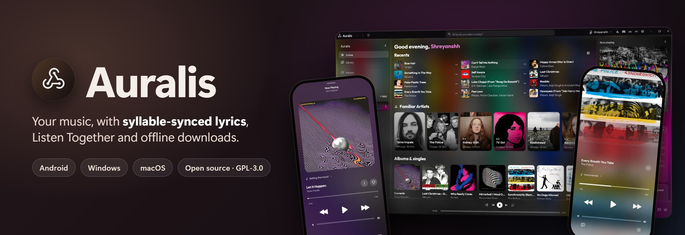

  <br />
  <br />

  <a href="https://github.com/Shreyanshh071/Auralis/releases/latest"></a>
  <a href="https://github.com/Shreyanshh071/Auralis/releases/tag/windows-v1.0.0"></a>
  <a href="https://github.com/Shreyanshh071/Auralis/releases/tag/v1.0.1-macos"></a>
  <br />
  <a href="https://discord.gg/6Q2YKz73S"></a>

  <br />
  <br />

  
  -32CD32?style=for-the-badge&logo=android&logoColor=white)
  
  
  
  
  [](https://www.buymeachai.in/shreyanshh071)

  <br />

  **Auralis** is an ad-free music player that streams from YouTube Music — built natively with **Jetpack Compose** and **AndroidX Media3** on Android, and **Compose Multiplatform** on Windows and macOS.

  <br />

  [Website](https://auralis-self-nu.vercel.app) • [Download](#-download) • [Discord](https://discord.gg/6Q2YKz73S) • [Screenshots](#-screenshots) • [Features](#-key-features) • [FAQ](#-frequently-asked-questions-faq) • [Tech Stack](#%EF%B8%8F-architecture--tech-stack) • [Credits](#-credits) • [Sponsor](#-sponsor-this-project)

</div>

> [!WARNING]
> **Regional Restriction** — If YouTube Music is unavailable in your region, this app will not work without a VPN or proxy connecting to a supported region.

---

## 🎤 Lyrics that move

<div align="center">
<table>
<tr>
<td align="center" valign="middle" width="28%">
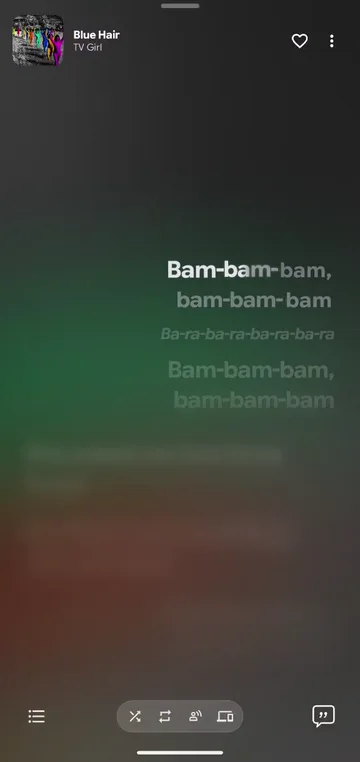<br />
<sub><b>Android</b></sub>
</td>
<td align="center" valign="middle" width="72%">
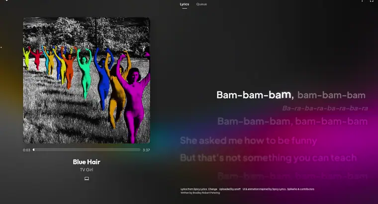<br />
<sub><b>Windows &amp; macOS</b></sub>
</td>
</tr>
</table>
<sub>Every syllable lights up as it is sung, and duet parts sit on their own side.</sub>
</div>

---

## 📦 Download

| Platform | Download | Notes |
| :--- | :--- | :--- |
| **Android** | [Auralis-v1.1.4-universal.apk](https://github.com/Shreyanshh071/Auralis/releases/latest) | Android 7.0+ · [Release notes](docs/release-notes-v1.1.4.md) |
| **Windows** | [Auralis-1.0.0.msi](https://github.com/Shreyanshh071/Auralis/releases/tag/windows-v1.0.0) | Installer · updates itself from Settings → Updates |
| **macOS** | [Auralis-1.0.1.dmg](https://github.com/Shreyanshh071/Auralis/releases/tag/v1.0.1-macos) | Beta |

The APK (~41 MB) supports Android 7.0+ devices with `arm64-v8a`, `armeabi-v7a`, `x86`, or `x86_64` CPUs — one download works on all of them.

---

## 📸 Screenshots

<div align="center">
  
</div>

<details>
<summary><b>See every screen, labelled</b></summary>
<br />

<div align="center">
  <table>
    <tr>
      <td align="center" width="25%">
        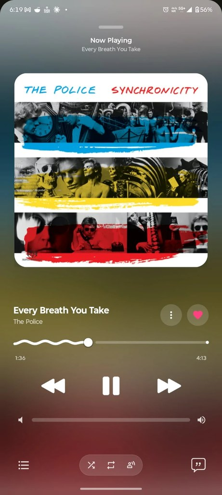<br />
        <sub><b>Now Playing</b></sub>
      </td>
      <td align="center" width="25%">
        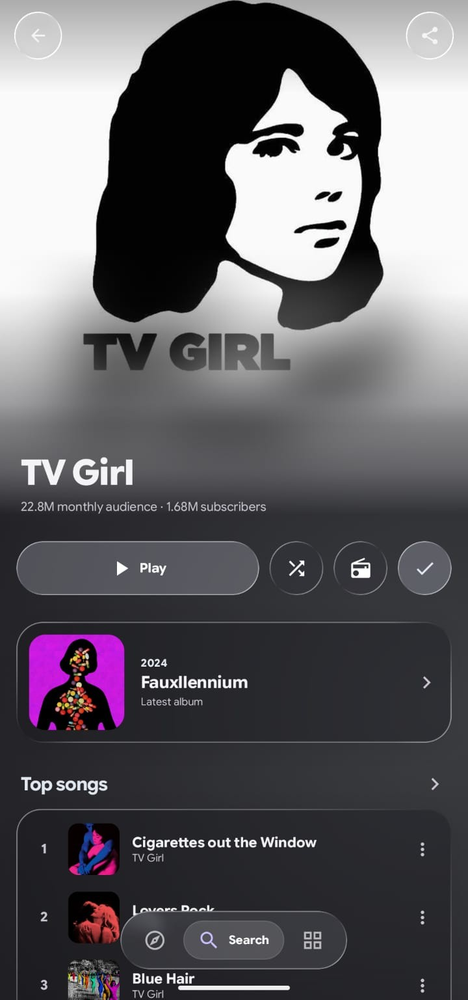<br />
        <sub><b>Artist Discography</b></sub>
      </td>
      <td align="center" width="25%">
        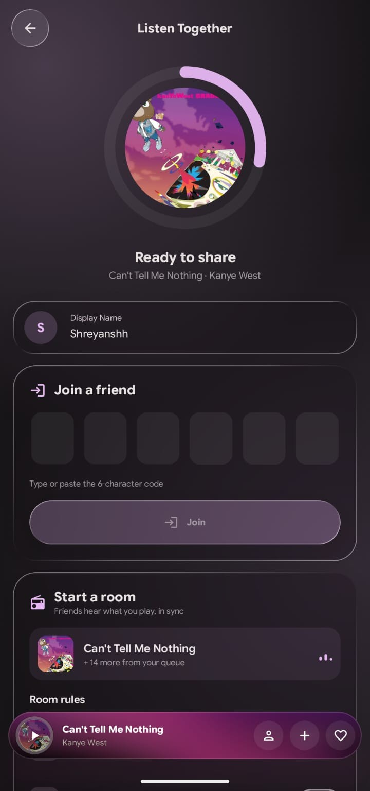<br />
        <sub><b>Listen Together</b></sub>
      </td>
      <td align="center" width="25%">
        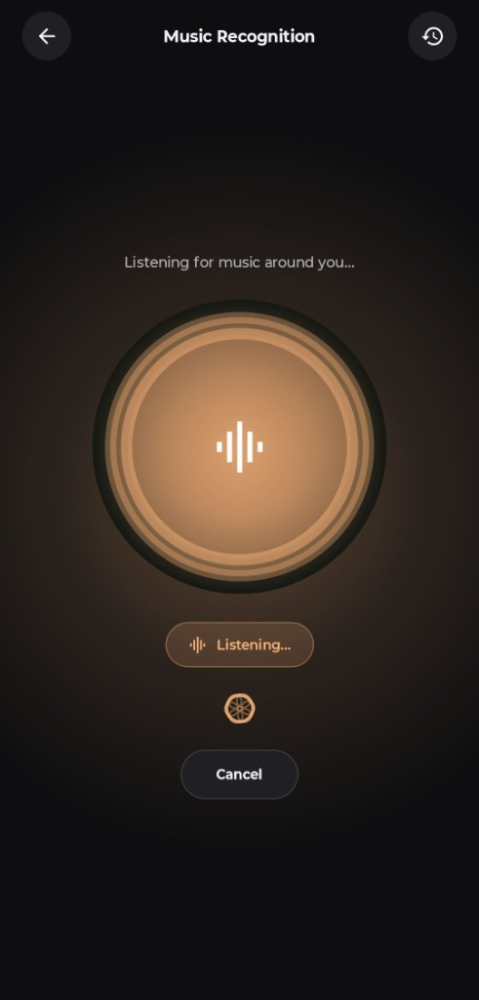<br />
        <sub><b>Music Recognition</b></sub>
      </td>
    </tr>
    <tr>
      <td align="center" width="25%">
        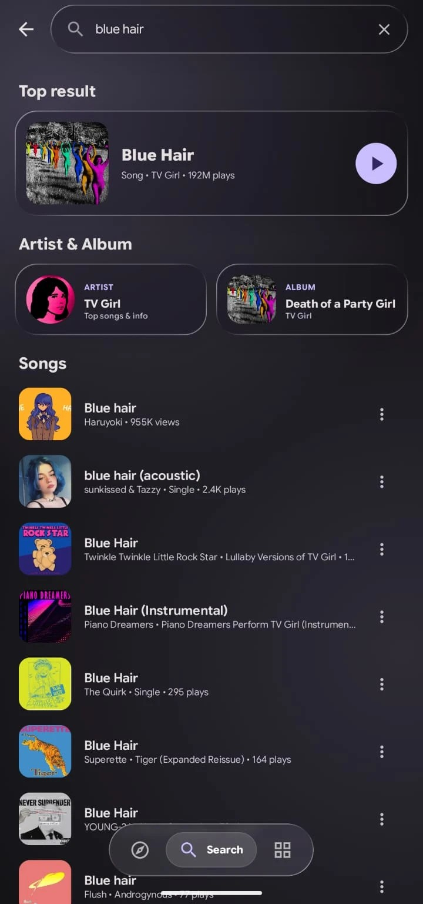<br />
        <sub><b>Search & Discovery</b></sub>
      </td>
      <td align="center" width="25%">
        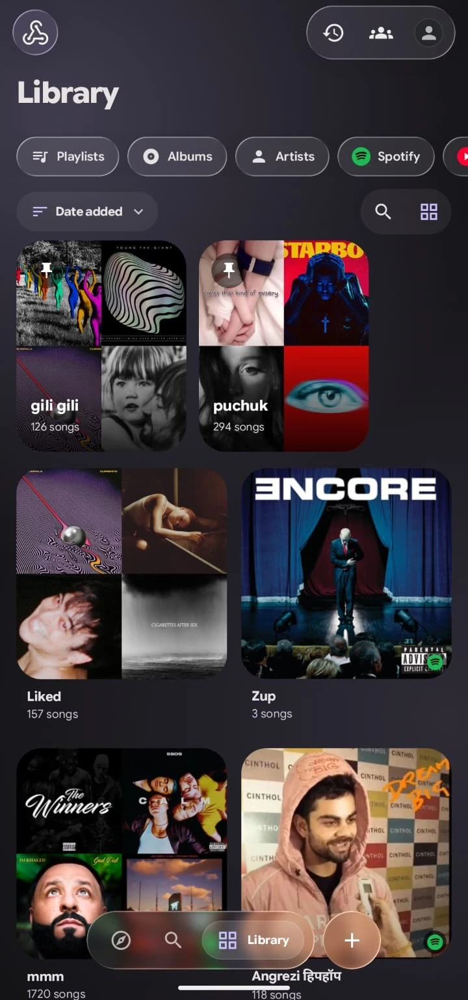<br />
        <sub><b>Library</b></sub>
      </td>
      <td align="center" width="25%">
        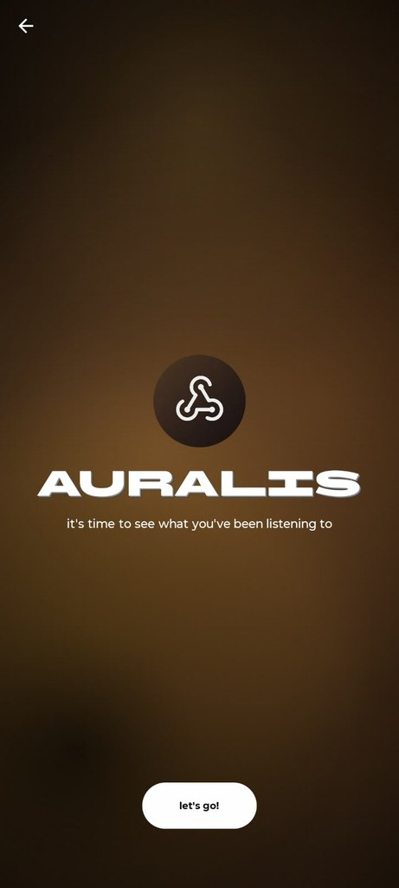<br />
        <sub><b>Auralis Wrapped</b></sub>
      </td>
      <td align="center" width="25%">
        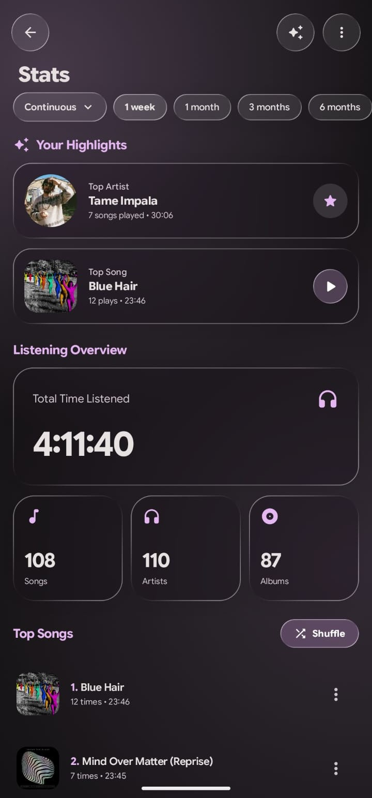<br />
        <sub><b>Listening Stats</b></sub>
      </td>
    </tr>
    <tr>
      <td align="center" width="25%">
        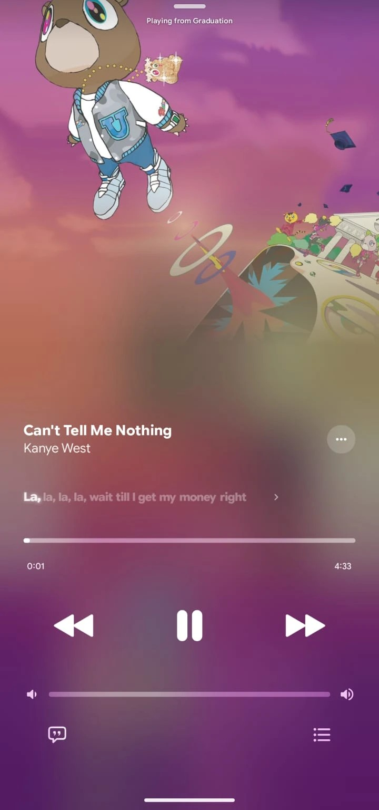<br />
        <sub><b>Immersive Player</b></sub>
      </td>
      <td align="center" width="25%">
        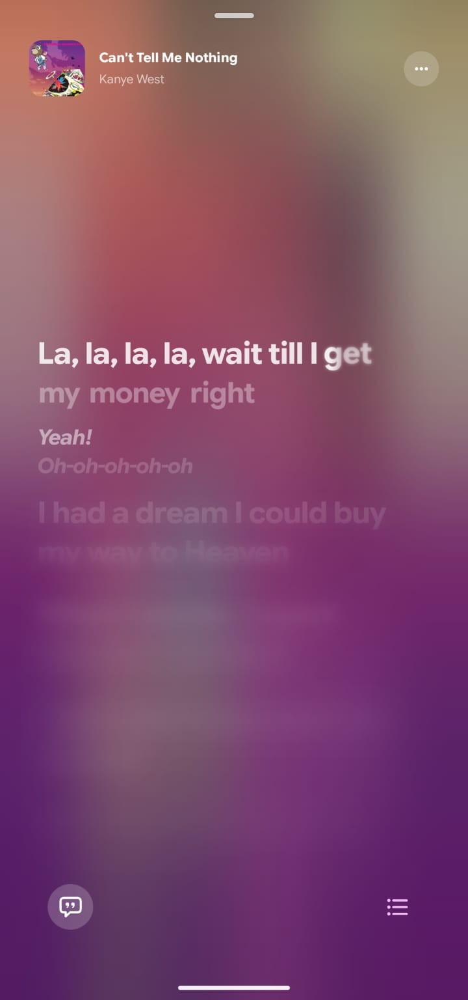<br />
        <sub><b>Player · Lyrics</b></sub>
      </td>
      <td align="center" width="25%">
        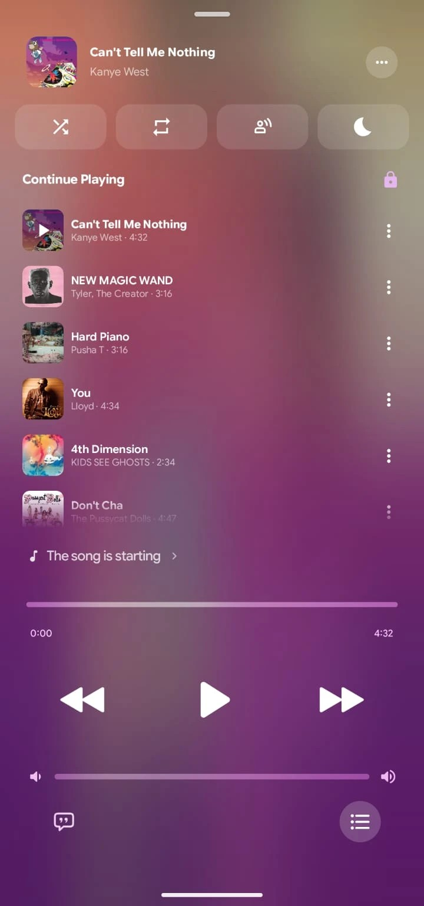<br />
        <sub><b>Player · Queue</b></sub>
      </td>
    </tr>
  </table>
</div>

</details>

---

## ✨ Key Features

<table>
<tr>
<td align="center" width="33%" valign="top">
<h3>🎤</h3>
<b>Syllable-synced lyrics</b><br />
<sub>Every word and syllable lights up as it is sung, from 14 lyrics sources, with translation and romanization.</sub>
</td>
<td align="center" width="33%" valign="top">
<h3>👥</h3>
<b>Listen Together</b><br />
<sub>Share a room code and hear the same song, in sync, with your friends.</sub>
</td>
<td align="center" width="33%" valign="top">
<h3>🔁</h3>
<b>Auralis Connect</b><br />
<sub>Move playback between your phone and PC, and control either one from the other.</sub>
</td>
</tr>
<tr>
<td align="center" width="33%" valign="top">
<h3>⬇️</h3>
<b>Offline downloads</b><br />
<sub>Save songs and whole playlists, plus a cache that replays what you have heard.</sub>
</td>
<td align="center" width="33%" valign="top">
<h3>📊</h3>
<b>Real listening stats</b><br />
<sub>Measured listening time, top songs and artists, and your own Wrapped.</sub>
</td>
<td align="center" width="33%" valign="top">
<h3>💜</h3>
<b>Your library, everywhere</b><br />
<sub>Import from Spotify and YouTube Music, and sync it all with your Auralis account.</sub>
</td>
</tr>
</table>

<details>
<summary><b>See the full feature list</b></summary>
<br />

<table>
<tr>
<td valign="top" width="50%">

#### Playback

- **Play anything available on YouTube Music** — search, browse and listen.
- **Offline downloads** — save songs and whole playlists.
- **Offline song cache** — songs you've played can replay without internet, up to a size you choose.
- **Gapless playback** and **Spatial Audio**.
- **Persistent queue** — your queue is still there when you reopen the app.
- **Endless listening** — more songs load automatically when your queue is about to finish.
- **Audio quality options** — choose Auto, High, Standard or Data Saver.
- **Sleep timer** to stop playback when you're done.
- **Background playback** with lock-screen and notification controls.

#### Discovery

- **Smart search** — suggestions as you type, ranked by relevance and play counts.
- **Music recognition** — identify songs playing around you.
- **Personal Home and Speed Dial** — built from your real listening.
- **Artist and album pages** — top songs, albums, singles and related artists.

#### Together & Accounts

- **Listen Together** — join a room with a code and hear the same song with friends.
- **Auralis Connect** — move your music between your phone and PC, and control playback from either one.
- **Spotify integration** — sign in to bring over your playlists and Liked Songs.
- **Playlist import** for Spotify and YouTube Music.
- **Discord Rich Presence** — show your song, artist, cover and progress.
- **Listening stats** — real listening time, top songs, top artists and Wrapped.
- **Cloud sync** — back up your likes, playlists, artists, stats and settings with your Auralis account.

</td>
<td valign="top" width="50%">

#### Lyrics

- **Syllable-synced lyrics** — every word and syllable lights up as it's sung, with fluid animations that go well beyond standard animated lyrics. Sync and motion at this level are rarely found in a music player.
- **Lyrics providers** — credit to [Spicy Lyrics](https://github.com/Spikerko/spicy-lyrics), [Better Lyrics](https://github.com/better-lyrics/better-lyrics), [AMLL](https://github.com/amll-dev/amll-ttml-db), [LyricsPlus](https://github.com/ibratabian17/LyricsPlus), [Paxsenix](https://lyrics.paxsenix.org), [Unison](https://unison.boidu.dev), [LRCLIB](https://lrclib.net), [Musixmatch](https://www.musixmatch.com), [KuGou](https://www.kugou.com), [QQ Music](https://y.qq.com), [NetEase](https://music.163.com), [JioSaavn](https://www.jiosaavn.com), [Genius](https://genius.com) and [YouTube Music](https://music.youtube.com).

- **AI translation and romanization**, including Pinyin and Romaji, for supported songs.
- **Lyric cards** — share your favourite lines as images.
- **Offline lyrics** — lyrics are saved once fetched.

#### Experience

- **Liquid Glass mode** — a see-through glass look for the dock, buttons, sheets and menus on dark themes.
- **Animated album canvas** — motion artwork on the now-playing screen.
- **Three player designs** — New, Old and Immersive.
- **Artwork-driven colours** — the player takes its colours from the current song.
- **High-resolution artwork** and smooth motion on 90/120 Hz displays.
- **In-app updates** — download new versions right inside Auralis.

</td>
</tr>
</table>

</details>

---

## 🛠️ Architecture & Tech Stack

| Layer | Technologies |
| :--- | :--- |
| **UI & Presentation** | [Jetpack Compose](https://developer.android.com/jetpack/compose) (Android) & [Compose Multiplatform](https://www.jetbrains.com/lp/compose-multiplatform/) (Desktop: Windows & macOS), [Material 3](https://m3.material.io/), [Haze Blur](https://github.com/chrisbanes/haze), [Coil 2.7](https://coil-kt.github.io/coil/) |
| **Audio Engine** | [AndroidX Media3](https://developer.android.com/media/media3) (`ExoPlayer`) on Android, libVLC / VLCJ on Desktop |
| **Concurrency & Reactive** | [Kotlin Coroutines](https://kotlinlang.org/docs/coroutines-overview.html), [StateFlow & SharedFlow](https://developer.android.com/kotlin/flow) |
| **Local Persistence** | [Room Database](https://developer.android.com/training/data-storage/room) (`AuralisDatabase`), [AndroidX DataStore](https://developer.android.com/topic/libraries/architecture/datastore) |
| **Networking & Extraction** | [OkHttp 4](https://square.github.io/okhttp/), Custom InnerTube Web Client, NewPipe Extractor |
| **Backend & Sync** | [Firebase Auth](https://firebase.google.com/products/auth), [Cloud Firestore](https://firebase.google.com/products/firestore), Google Sign-In |
| **Discord** | [Discord Social SDK](https://discord.com/developers/docs/discord-social-sdk/overview) (Rich Presence) |

---

## 📂 Project Structure

<details>
<summary><b>Show the folder layout</b></summary>

```
Auralis/
├── android/
│   └── app/
│       ├── src/main/
│       │   ├── java/com/auralis/music/
│       │   │   ├── data/
│       │   │   │   ├── datastore/      # Preferences & Settings DataStore
│       │   │   │   ├── download/       # Offline Audio Download Manager
│       │   │   │   ├── local/          # Room DB, DAOs, Entities
│       │   │   │   ├── network/        # InnerTubeClient, LyricsClient, Spotify/YT Importers
│       │   │   │   ├── parser/         # LRC & TTML timestamp parsers, LyricsMatcher
│       │   │   │   ├── repository/     # Repository implementations
│       │   │   │   ├── service/        # AuralisAudioPlayer, YouTubeAudioEngine
│       │   │   │   └── sync/           # ListenTogetherManager & Math Engine
│       │   │   ├── domain/             # Domain Models, Auth & Interfaces
│       │   │   ├── service/            # AuralisMediaService (Media3 Session & Deck)
│       │   │   ├── ui/                 # Jetpack Compose UI
│       │   │   │   ├── components/     # Reusable UI Cards, Modals, Pills
│       │   │   │   ├── home/           # HomeScreen, SpeedDial & Sections
│       │   │   │   ├── explore/        # Search & Explore screens
│       │   │   │   ├── library/        # Playlists, Downloads & History
│       │   │   │   ├── lyrics/         # Synced Lyrics & Lyric Card Creator
│       │   │   │   ├── player/         # MiniPlayer & NowPlaying Fullscreen Modal
│       │   │   │   ├── screens/        # ArtistScreen, Settings & Sub-views
│       │   │   │   └── viewmodel/      # Architecture ViewModels
│       │   │   └── MainActivity.kt     # Main Android Entry Point
│       │   └── res/                    # Drawables, icons, layout values
│       └── build.gradle.kts
├── windows/                            # Desktop app (Compose Multiplatform for Windows & macOS)
├── windows-core/                       # Desktop core models, playback controller & services
├── shared/                             # Kotlin Multiplatform code shared between Android & Desktop
├── zemer-cipher/                       # Vendored YouTube cipher / PO token module
├── gradle/                             # Wrapper & version catalog (libs.versions.toml)
├── build.gradle.kts                    # Root Gradle build (run ./gradlew from the repo root)
├── settings.gradle.kts
├── .github/
│   └── FUNDING.yml                     # Sponsor Configuration
└── README.md
```

</details>

---

## ❓ Frequently Asked Questions (FAQ)

<details>
<summary><b>Why is the APK about 41 MB?</b></summary>
<br>

Two add-ons make up most of it:

- **Discord's official SDK** for Rich Presence (~15 MB), which ships native code for each of the four CPU types the APK supports.
- **An offline Japanese dictionary** (~13 MB, [Kuromoji](https://github.com/atilika/kuromoji)) that turns Japanese lyrics into romaji without an internet connection.

The app itself — native **Jetpack Compose** and **AndroidX Media3**, shrunk with **R8** — is about 9 MB.
</details>

<details>
<summary><b>Which APK should I download? Do I need to know my phone's CPU architecture?</b></summary>
<br>

Download `Auralis-v1.1.4-universal.apk` from the [latest release](https://github.com/Shreyanshh071/Auralis/releases/latest). It supports Android 7.0+ devices using `arm64-v8a`, `armeabi-v7a`, `x86`, or `x86_64`; you do not need to choose a separate APK for those CPUs.
</details>

<details>
<summary><b>How does Auralis recommend music for brand-new users?</b></summary>
<br>

Fresh installs start with a starter set of songs from curated artists (*Tame Impala, Kanye West, Karan Aujla, Radiohead, KR$NA, Arijit Singh, KK, Shreya Ghoshal, Atif Aslam*) with non-music noise spam filtered out. Once you start listening, recommendations adapt to what you actually play.
</details>

<br />

> 🌐 **Have more questions?** Visit our official website & help center at **[auralis-self-nu.vercel.app/#faq](https://auralis-self-nu.vercel.app/#faq)** for additional FAQs, setup guides, and feature walkthroughs — or ask the community on **[Discord](https://discord.gg/6Q2YKz73S)**.

---

## 🙏 Credits

Auralis is built on the work of many people. Thank you to all of them.

**Lyrics**

- **[Spicy Lyrics](https://github.com/Spikerko/spicy-lyrics)** by Spikerko — syllable-synced lyrics, and the inspiration for the Spicy lyric style in Auralis.
- **[Better Lyrics](https://github.com/better-lyrics/better-lyrics)**, **[Unison](https://unison.boidu.dev)**, **[LyricsPlus](https://github.com/ibratabian17/LyricsPlus)** and **[Paxsenix](https://lyrics.paxsenix.org)** — word-synced lyrics.
- **[AMLL TTML Database](https://github.com/amll-dev/amll-ttml-db)** — community-made word-synced lyrics.
- **[LRCLIB](https://lrclib.net)** — open, community-synced lyrics.
- **[Musixmatch](https://www.musixmatch.com)**, **[KuGou](https://www.kugou.com)**, **[QQ Music](https://y.qq.com)**, **[NetEase](https://music.163.com)**, **[JioSaavn](https://www.jiosaavn.com)**, **[Genius](https://genius.com)** and **[YouTube Music](https://music.youtube.com)** — lyrics.

**Music & playback**

- **[NewPipe Extractor](https://github.com/TeamNewPipe/NewPipeExtractor)** — YouTube Music streams and metadata.
- **[Zemer Cipher](https://github.com/ZemerTeam/zemer-cipher)** by alltechdev and the Zemer team — age-restricted downloads, along with the upstream work credited there, including yt-dlp, NewPipe and BgUtils.
- **[Media3 / ExoPlayer](https://github.com/androidx/media)** — audio and animated cover playback.
- **Apple Music**, **Tidal** and **Vivi Music** — animated album canvas sources.
- **[Vivi Music](https://github.com/vivizzz007/vivi-music)** — the approach behind the JioSaavn 320kbps audio in High Quality (GPL-3.0).
- **[Kuromoji](https://github.com/atilika/kuromoji)** — offline Japanese tokenisation and kanji readings (Apache-2.0).

**Design & interface**

- **[BitChord](https://github.com/kushagrasinghx/BitChord)** by kushagrasinghx — Apple Music artist photo lookup (GPL-3.0).
- **[Metrolist](https://github.com/MetrolistGroup/Metrolist)** — a reference for Content settings and interface details.

**Services**

- **[Discord Social SDK](https://discord.com/developers)** — Rich Presence.
- **[Firebase](https://firebase.google.com)** — accounts, sync and Listen Together.

All lyrics, artwork and trademarks belong to their respective owners.

---

## 💖 Sponsor This Project

If you love using **Auralis** and want to support its ongoing development:

[](https://www.buymeachai.in/shreyanshh071)

Your support helps keep the project fast, 100% ad-free, open-source, and constantly improving!

---

## 📄 License

This project is free and open-source software licensed under the **[GNU General Public License v3.0 (GPL-3.0)](LICENSE)**.
You are free to use, modify, and distribute this software under the terms and copyleft protections of the GPL-3.0 license.

> **Closed-source components:** the release APK also includes Google's Firebase SDKs (sign-in, backup, update notifications) and Discord's official Social SDK (Rich Presence). The Discord SDK can't be redistributed, so it isn't in this repository; to build Auralis yourself, add it locally as described in `.gitignore`.
